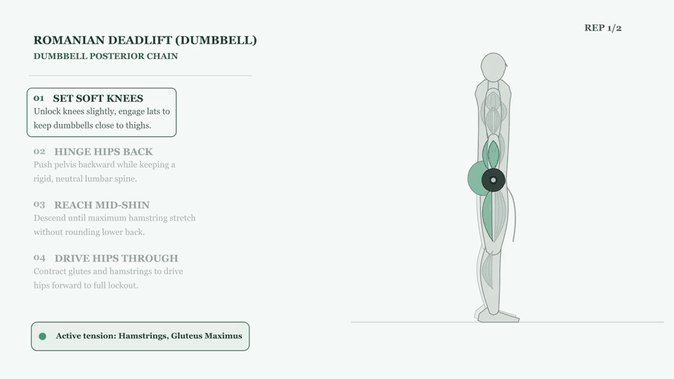

# Autonomous Kinesiology Graph

**Type an exercise name; get a biomechanically described record and a technical animation in your database.**


<p align="center">
  
</p>

<p align="center"><sub>Generated end to end by the pipeline from the words "peso muerto rumano" (dumbbell variant): coaching steps with the active one highlighted, muscle tension in green, force arrows and live joint angles.</sub></p>

---

## What it does

- **Understands a loose request.** Type an exercise in Spanish (typos and slang welcome). The agent proposes its real variants (barbell, dumbbell, single-leg, cable, etc.), shows which ones are already in the database, and lets you pick several.
- **Writes the exercise record.** Force, mechanic, equipment and category; primary and secondary muscles; setup, execution steps, breathing and common mistakes. Everything is validated against a typed schema.
- **Animates the technique.** It produces a 1280×720 technical video and a still: a side-view anatomical figure with tension-coloured muscles, force vectors, joint angles and step-by-step coaching.
- **Loads it idempotently.** Media goes to Supabase Storage and the record to Postgres. Each chosen variant is processed in parallel.

## How it works

```
"peso muerto rumano"
        │
        ▼
 Variant resolver (Gemini) ──► DB lookup ──► pick variants in the terminal
        │
        ▼   one LangGraph run per variant, in parallel
 ┌────────────────────────────────────────────────────────────────────────────────┐
 │ content ─► animation spec ─► visual review ─► Manim render ─► Storage ─► Postgres │
 │ (Gemini)   (Gemini, checked)  (Gemini sees     (local, free)                       │
 │                               the key poses)                                     │
 └────────────────────────────────────────────────────────────────────────────────┘
```

The key idea: **the LLM does not draw, it describes.** Gemini returns a validated *animation spec* for one repetition: the setup (posture, bench or seat, machine or cable, planted hands and feet), keyframes where each limb is either joint angles or a hand/foot target, muscle tension per keyframe, coaching steps, force arrows and the joints whose angles matter. A deterministic renderer built on Manim solves the pose (inverse kinematics, posture-aware anchoring), draws the bench, rack, machine or cable station from the setup, and turns the spec into the video. The output is consistent, technically readable, costs nothing to render, and covers standing, seated, lying, hanging, plank and bridge exercises in side view, plus frontal-plane movements in front view.

## Engineering highlights

- **Self-healing LLM loop.** Specs go through three checks. Pydantic validators check structure. A geometry engine then checks anatomy and physics: joint ranges measured relative to the neighbouring segment (so they hold lying, seated or hanging), the back stays on the bench, planted hands and feet stay within reach, a barbell never passes through the chest, head or bench, machine paths are straight or arcs, and the load stays over mid-foot in hinges and squats. Finally a visual critic renders the key poses and asks Gemini (multimodal) whether a coach would accept them. Each problem goes back to Gemini as a concrete fix ("the load sinks 0.16 units into the torso; move the near_arm target out"), with up to three attempts.
- **Movement-family examples.** The variant resolver classifies each exercise (hinge, squat, lunge, presses, pulls, curls, raises...) at no extra cost, and the spec prompt shows the hand-tuned sample specs of that family.
- **Deterministic rendering instead of generative video.** The project started with Imagen and Veo. They were dropped because they could not draw accurate force lines, angles or text, they gave different results on every run, and they were slow and paid. A spec plus a renderer fixed all three.
- **Pure, tested geometry.** Forward and inverse kinematics with fixed bone lengths, posture-aware anchoring, automatic framing, scenery geometry, the anatomy checks and collision-aware label placement live in plain Python (`skeleton.py`, `kinematics.py`, `checks.py`, `scenery.py`, `layout.py`). That code is unit-tested without Manim, and the scene only draws.
- **Concurrency where it pays.** Variants run in a thread pool. CPU-bound Manim renders are capped by a semaphore. Uploads are serialised over HTTP/1.1 with retries, after real parallel HTTP/2 uploads failed with dropped connections.
- **Data integrity.**
  - One deterministic slug rule is shared by the DB lookup, the upsert key and the Storage path.
  - Overwriting an existing exercise needs explicit confirmation.
  - The upsert never replaces a good media URL with an empty one.
  - Every upload is verified by comparing the remote object size with the local file.
- **Failure isolation.** Graph nodes never raise. They report errors in the state and the graph decides what to do next. One failing variant never stops the others, and the summary says exactly what happened to each one.
- **Tested offline.** About 200 tests run with every external client (Gemini, Postgres, Storage, Manim) faked, including every sample spec through the geometry checks. Opt-in tests run real renders.

## Tech stack

| Area | Tools |
|---|---|
| Agent orchestration | LangGraph (`StateGraph` with conditional retry edges) |
| LLM | Google Gemini via `langchain-google-genai`, Pydantic structured output |
| Rendering | Manim (Cairo), NumPy, PyAV for still extraction |
| Storage & data | Supabase Postgres (`psycopg` 3) and Supabase Storage |
| Quality | pytest, monkeypatched fakes, typed models (Pydantic v2) |

## Project structure

```
main.py                 Interactive CLI: request → variants → concurrent generation → summary
src/
  graph.py              LangGraph wiring and retry routing
  domain/               Pydantic models: exercise record, animation spec, graph state
  nodes/                One node per step: content, spec, visual critic, render, storage, database
  rendering/            Geometry (skeleton, kinematics, checks, scenery, layout), side and front bodies,
                        Manim scene, storyboard, render runner
  resolution/           Variant resolver (natural language → concrete variants)
  pipeline/             Concurrent execution of the selected variants
  cli/                  Terminal dialogue (Spanish)
  infrastructure/db/    Supabase Storage client and read-only repository
samples/specs/          Hand-tuned animation specs by movement family (prompt examples and test fixtures)
render_spec.py          Render any spec locally without API keys
upload_media.py         Re-upload rendered media for stored exercises
init_db.py              Database schema
tests/                  Offline test suite
```

## Getting started

**Prerequisites:** Python 3.12, a Gemini API key, and a Supabase project with two **public** Storage buckets: `exercise_videos` and `exercise_images`.

```bash
git clone https://github.com/JuanXiRP/autonomous-kinesiology-graph.git
cd autonomous-kinesiology-graph
python -m venv .venv
.venv\Scripts\activate            # macOS/Linux: source .venv/bin/activate
pip install -r requirements.txt
cp .env.example .env              # then fill in your keys
python init_db.py                 # creates the `exercises` table
python main.py "peso muerto rumano"
```

Each generated variant costs three Gemini calls (content, spec, visual review; more when a spec is retried), plus one call for the variant list, and about 4 minutes of local rendering.

**Try the renderer without any keys:**

```bash
python render_spec.py samples/specs/bench_press_barbell.json barbell "Bench Press (Barbell)"
# add --frame 3.5 to render a single frame in ~20 seconds
python render_spec.py --gallery   # one frame of every sample in a contact sheet
```

The output goes to `media/previews/`. Every generated spec is also saved to `media/specs/<slug>.json`, so a pipeline result can be re-rendered for free.

## Example session

The terminal speaks Spanish; the data is stored in English. Output trimmed.

```text
¿Qué ejercicio quieres generar? peso muerto rumano

  1) Peso muerto rumano con barra — romanian_deadlift_barbell  [ya en BD, 08/10/2026]
  2) Peso muerto rumano con mancuernas — romanian_deadlift_dumbbell
  3) Peso muerto rumano a una pierna con mancuerna — single-leg_romanian_deadlift_dumbbell
  4) Peso muerto rumano con pesa rusa — romanian_deadlift_kettlebell
  ...

¿Cuáles quieres generar? (ej. 1,3 · 1-6 · todos · Enter para cancelar): 1,2,3
  'Peso muerto rumano con barra' ya existe. ¿Regenerarlo y sobrescribirlo? (s/N): N
¿Generar? (s/N): s

romanian_deadlift_dumbbell | 🎞️ [Render] Rendering animation with Manim...
single-leg_romanian_deadlift_dumbbell | 🎞️ [Render] Rendering animation with Manim...
...
📋 Resumen
  <per variant: creado / actualizado / guardado sin vídeo / falló, with its video and image URLs>
```

## Testing

```bash
pip install -r requirements-dev.txt
pytest            # offline suite, no network
pytest -m slow    # real Manim renders of the sample specs
```

## Limitations & roadmap

- **Schematic body.** The figure is a vector illustration. A photoreal restyle of the rendered keyframes is a possible next step.
- **Projection.** Side view is a 2D projection: movements that are mostly rotational or diagonal (wood chops, Turkish get-ups) are only approximated, the front view supports upright postures with free weights, cables or lever machines, and transverse-plane machines (pec deck) would need a top view.
- **Muscle names.** Names coming from the LLM are not normalised to a fixed vocabulary yet.
- **Render time.** About 4 minutes per variant on a laptop CPU. Renders run two at a time.
- **Companion app.** The vocabulary still needs mapping to the free-exercise-db format used by the companion fitness app.

## License

[MIT](LICENSE)

## Author

**JuanXiRP** · [github.com/JuanXiRP](https://github.com/JuanXiRP)
